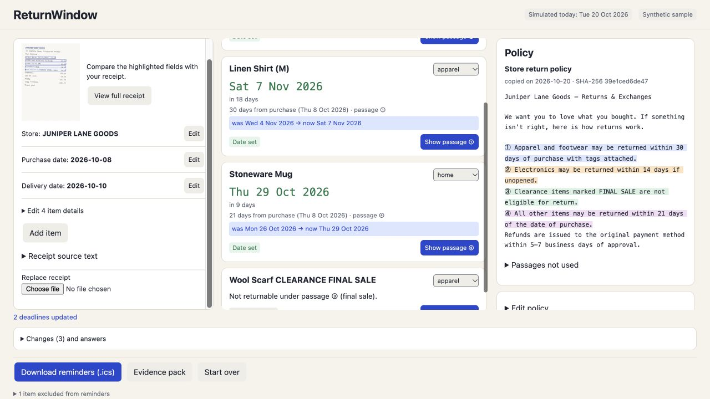

# ReturnWindow

Know the last day to return each item, and the policy line that proves it.

ReturnWindow is a local browser app for Singapore shoppers with mixed-item receipts. Add a receipt and the store's supplied policy, review separate item deadlines, answer one question when a clock is ambiguous, and correct extraction mistakes. Download calendar reminders and a printable evidence pack. Sample data is synthetic. Not legal advice.

## Demo

[Watch the 2½-minute narrated walkthrough](https://youtu.be/kNPtMSZUJ-I). OpenAI Cedar narration and English captions; actual local product captures with synthetic data.

The demo follows a real local OCR run on a **synthetic receipt**. The visible simulated date is 20 October 2026. Correcting the extracted purchase date from 5 to 8 October changes the shirt and mug deadlines while leaving delivery-based earbuds unchanged. The final-sale scarf gets no invented date.



- Read photos locally with Tesseract, extract PDF text, or paste a receipt.
- Supply the store policy; inspect linked quotations and answer an ambiguous clock question.
- Correct extracted fields and see which item dates change.
- Export calendar reminders and a self-contained HTML evidence pack.
- Restore one imageless local case after reload; Start over clears it.

No account, backend, receipt-upload service or API key is needed. No generative model decides the return dates. Review the policy conditions before relying on a result; this is not legal advice.

### Validation

The accepted core passed **131 unit tests, 49 date/engine checks in each of three timezones, 13 OCR/adapter checks and 6 production browser tests**. A fresh local production build and actual demo walkthrough also exercised OCR, correction, downloads, restore and clear. These are synthetic-fixture results, not general OCR-accuracy or user-outcome claims.

The 19 October evidence-layout build passed and its application measurements completed, but that bounded browser harness exited 1 at a defunct-process cleanup snapshot. Later process/group/port cleanup was independently verified. The failure is preserved in the [review](docs/process/evidence-notice-review-20261019.md); it is not relabelled as a passing test batch. See [full test results](docs/test-report.md).

The [reference app map](devpost/app-map.html) explains the correction-to-results path. It records agent checks separately from Johan's own activities.

## Run locally

Node 24 or later and pnpm 12.11.2 are required. No account, API key, Docker or backend is needed.

```sh
pnpm install --frozen-lockfile
pnpm dev
# http://127.0.0.1:5188
```

For a production preview:

```sh
pnpm build
pnpm preview
# http://127.0.0.1:4188/?today=2026-10-20
```

The `today` parameter visibly labels simulated today; without it the app uses Singapore's current date. Both ports bind only to 127.0.0.1 with strictPort. Installation and dev/build preparation copy local OCR worker/core/model assets from installed dependencies into ignored public/ocr/. The amended manifest totals 31,347,373 bytes across 13 files, including two model-specific local notices; its original 11 entries remain unchanged. The combined0909 build verified all13 public/dist assets, including exact source hashes for both added notices; its raw harness cleanup FAIL and later verified release are recorded separately. No CDN download occurs at build/run time.

Verification commands are `pnpm typecheck`, `pnpm test`, `pnpm test:tz`, `pnpm test:ocr` and `pnpm test:e2e`. E2E starts its own production build/preview with one Chromium worker; do not start another preview on 4188. In the shared hackathon environment, full suites/builds/OCR/browser runs require the master reservation protocol; a low load or queue entry is not a grant.

## How this works

Tesseract reads English receipt images on the device. PDF.js reads a PDF's text layer; pasted text and text files enter the same parser. Extracted fields retain their confidence and source boxes. Fixed rules identify policy windows and categories while preserving exact quotations and character offsets. Calendar-date arithmetic computes a separate deadline for each supported item. It asks about an unspecified clock start and refuses unsupported, missing or conflicting evidence.

The real synthetic messy receipt is read as **5 Oct 2026**, against ground truth **8 Oct 2026**. Before correction, the shirt is 4 Nov and mug 26 Oct. Answer delivery 10 Oct, then correct purchase 05→08: the shirt becomes 7 Nov, mug 29 Oct, and delivery-anchored earbuds stay 24 Oct. The final-sale scarf stays not returnable. The proven receipt/golden are preserved; no target misread is forced.

Calendar files include computed, unexpired items only. Events are all-day DATEs with next-day exclusive ends, a stable UID, verbatim stored store name and policy evidence. Absolute UTC alarms encode 09:00 Singapore on the preceding day. Evidence HTML contains escaped text, passages/offsets, full policy hash, answers, changes and an optional embedded raster receipt. It has no scripts or external fetch resources; printing hides the in-app controls.

A single imageless case is saved locally after a 300 ms debounce. Reload restores validated extracted text/evidence, not receipt pixels. **Start over clears it; reload cannot restore a deliberately cleared case.** Corrupt saved state is removed with a message. A compact receipt preview opens the full image when needed; desktop columns scroll within their reserved area, and mobile stacks below 720 px.

## Date convention

Dates are calendar dates in Singapore time (Asia/Singapore). The day of purchase or delivery counts as day 0. A 30-day window ends at the end of day 30. 'Days' with no qualifier are treated as calendar days. A one-month window ends on the same date next month, or on the month's last day if that date doesn't exist.

The original relative alarm recipe did not guarantee 09:00 Singapore when a calendar user had another timezone. [Decision 8](docs/decisions/plan-vs-spec.md) corrects the specification before implementation: for 24 Oct 2026 the alarm is 20261023T010000Z; for 7 Nov, 20261106T010000Z; for 29 Oct, 20261028T010000Z. DTSTART/DTEND stay DATE; no RELATED parameter is attached to the DATE-TIME trigger. Independent ical.js tests assert these instants and a year boundary.

## Modes, privacy and limits

Extraction: on-device OCR (Tesseract LSTM) + deterministic rules. No generative AI model is used to compute deadlines.

OCR/PDF are real local libraries. There are no sponsor APIs, remote models, analytics, fetched retailer policies or uploads. Production CSP restricts the app to same-origin assets; the standalone evidence file disables external sources. No P2 local category suggester is included. The browser holds images only in memory and releases object URLs/workers on cleanup; localStorage holds extracted text and evidence. Exported evidence may contain an image when explicitly included.

Only English policy clocks and SGD display are supported. The app does not interpret conditions such as “unopened”, determine legal rights/refund amounts, or compute business-day/public-holiday deadlines. Review quoted conditions and check with the store. OCR can misread confidently. Optional scanned-PDF browser and separate browser-unmount checks remain unexercised; labels must not imply they passed. Calendar-client import and final hands-on review remain Johan's.

## How it was built

The repository started empty on18 Oct 2026; its first action installed the [Devpost Learn Skill Pack](https://github.com/challengepost/learn-ai-basics), MIT ©2026 Devpost. Installed 1-start→2-scope→3-prd→4-spec generated the authentic [scope](devpost/scope.md), [PRD](devpost/prd.md), [spec](devpost/spec.md) and [5-build checklist](devpost/checklist.md). The installed 5-build workflow is used for implementation slices, verification, commits and explicit revisions. Learner-side product answers/approvals were delegated from an approved brief; personal answers, hands-on checks and final personal review remain Johan's. No learning reflection is fabricated.

Claude Opus 5.5 HIGH authored the original plan and G1/G2 reviews. GPT-6 Astra HIGH is the authorized quota-fallback specification/review lead for G3/G4 and decisions 8–11. GPT-6.1 Sol HIGH implements the application and tests. Neither planning lead writes implementation. The original plan was written outside the repo during the submission window and [copied into docs/opus after skill generation](docs/opus/README.md). See the [process record](docs/process/skill-pack-run-log.md). No pre-existing application code was incorporated.

React/Vite/TypeScript provide the interface and build; Tesseract/PDF.js provide local extraction; Zod validates storage. Vitest/fast-check test the kernel, dev-only ical.js/jsdom independently parse exports, and Playwright tests production Chromium. [Licences and provenance](docs/licenses.md) record the now-substantiated Apache-2.0 model chain separately from npm-package MIT metadata, preserve caniuse-lite CC-BY4.0 / dev-only mdn-data CC0 notices and record the completed13-asset source/public/dist comparisons separately from the raw0909 harness cleanup failure. See [supplementary notices](THIRD_PARTY_NOTICES.md). ical.js MPL-2.0 is dev-only. [MIT licence](LICENSE), ©2026 Jo2234.

Johan authorized this public source copy and demo preparation on 19 October 2026. The original development archive remains private. The Devpost entry remains a draft until Johan submits it. Personal hands-on/Calendar/print checkpoints in the historical records are not silently marked complete by publication. See the [submission preparation record](docs/submission-package/preparation-record.md).

Private19Oct [setup/package guide](docs/delivery-20261019/README-private-delivery.md) and delivery drafts: [release notes](docs/delivery-20261019/release-notes.md), [storyboard](docs/delivery-20261019/demo-storyboard.md), [submission draft](docs/delivery-20261019/submission-draft.md). These retain Astra draft attribution, Sol factual amendments and Johan personal placeholders; no publication or human sign-off is claimed.
